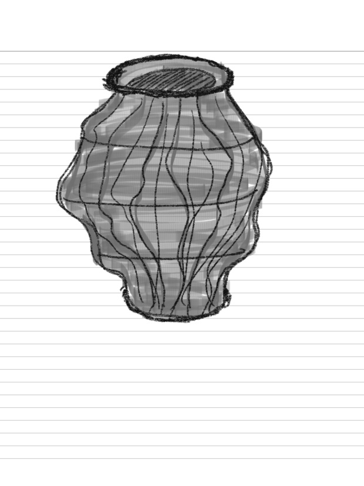
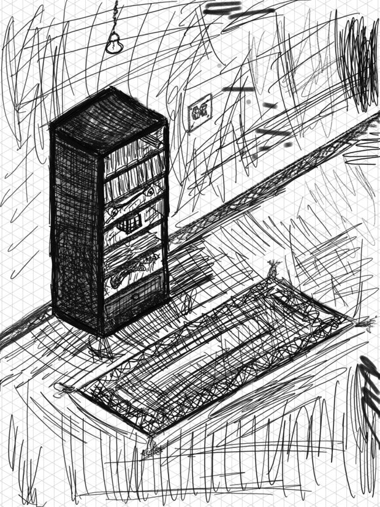
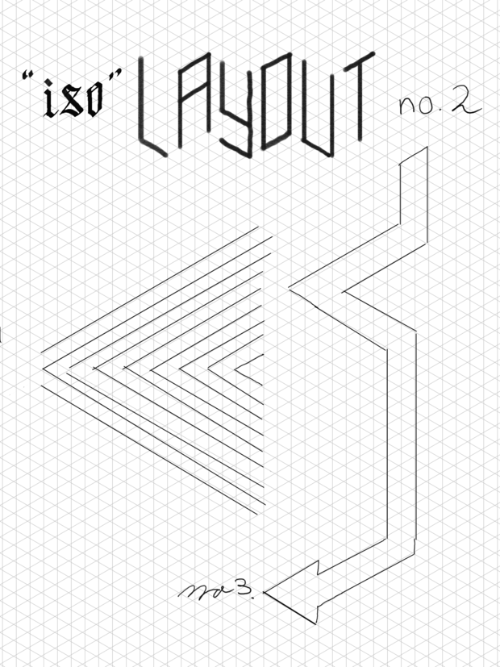
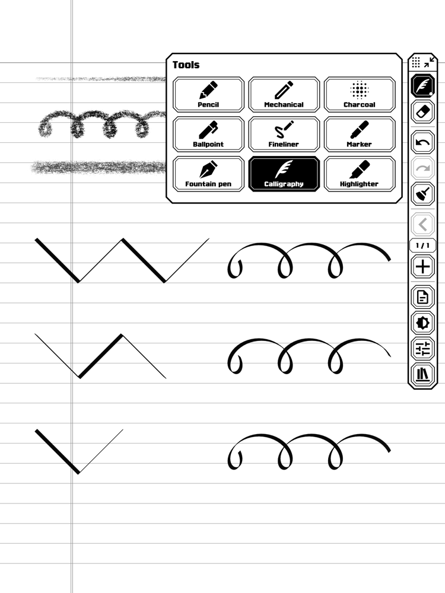
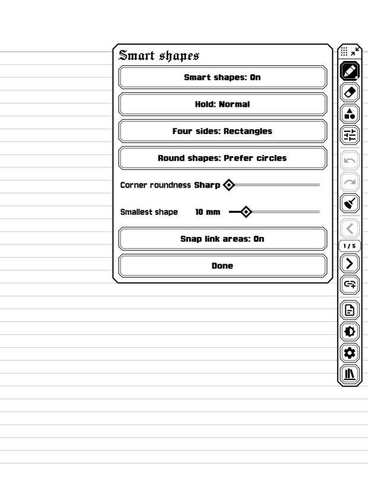
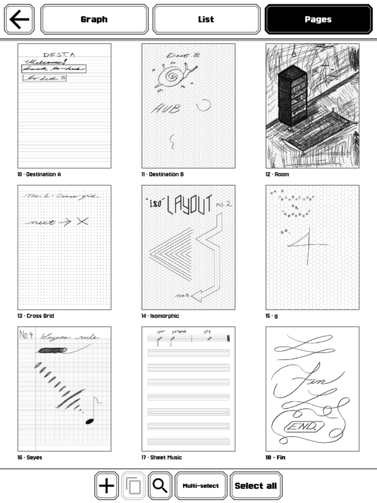
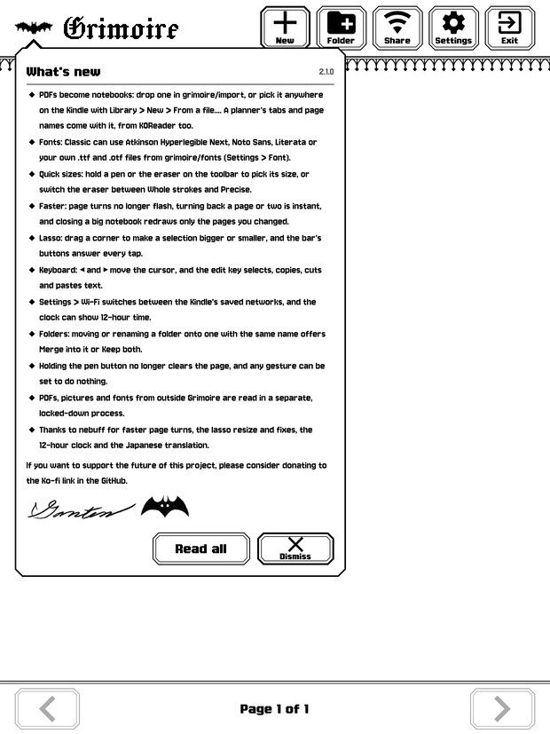
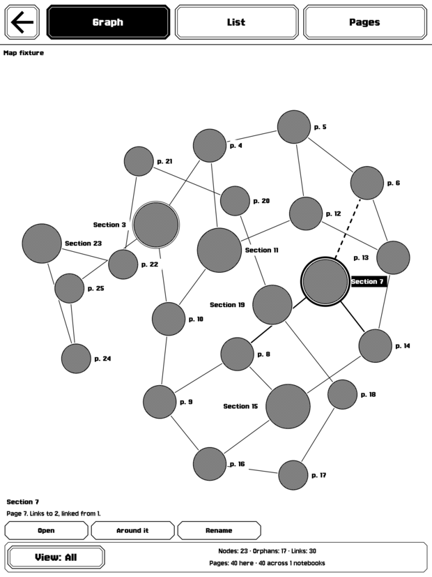
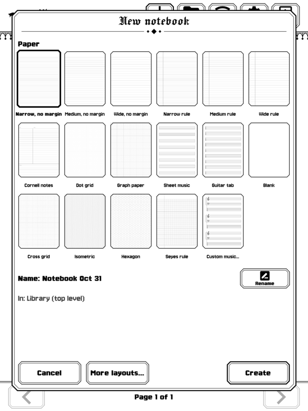
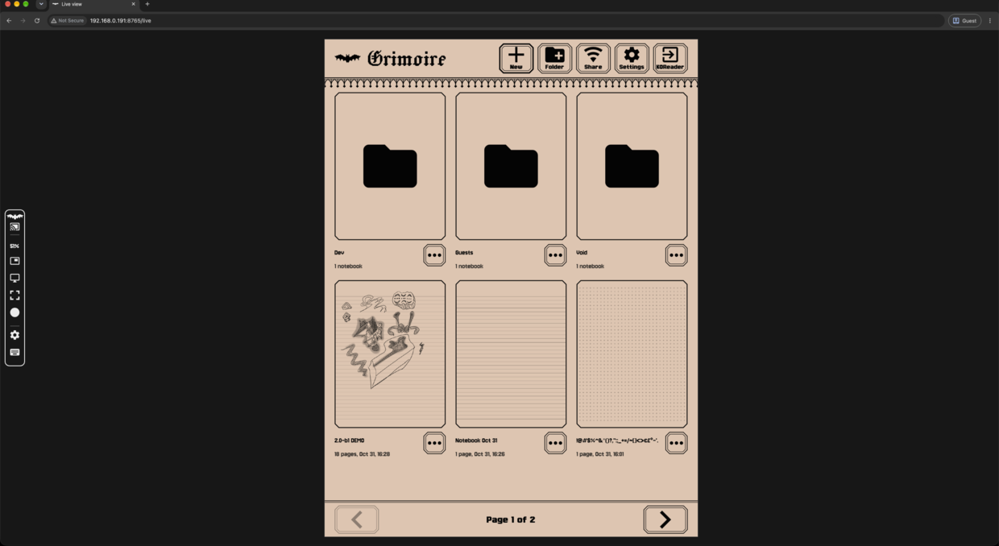

  <a href="README.md">English</a> | <strong>日本語</strong> | <a href="README-pl.md">Polski</a> | <em>その他の言語は近日公開</em>

<h1 align="center">
  <picture>
    <source media="(prefers-color-scheme: dark)" srcset="docs/logo-dark.png">
    
  </picture>
</h1>

**脱獄した Kindle Scribe のための手書きノート。** 罫線、ドット、方眼、コーネル式の用紙、
楽譜、ギター／ベースタブを自由に組み合わせて重ねられ、Scribe の筆圧と傾きに合わせた 9 種類の
ペン、フォルダ、そしてページを PDF や PNG としてパソコンに取り出す 3 つの方法があります。
すべては Kindle 上のオープンなファイルに保存されます。アカウントもクラウドも追跡もありません。

見た目は昔のコンソールゲームの城のようです。ピクセル風のブラックレターの見出し、ピクセル
フォント、石を彫ったような枠、尖ったアーチ（設定でワンタップすれば素朴な **Classic** スタイルに
なります）。

GPL-3.0 の自由ソフトウェアです。Amazon とは提携しておらず、承認も受けていません。

上のページはすべて Kindle Scribe の Grimoire で描いたものです。最後の画像はライブビューで、
書きながら Kindle の画面をパソコンのブラウザに表示しています。

## なぜ Grimoire か

- **自分の Kindle の中に、自分のものが残る。** ノートは `grimoire` フォルダ内のオープンな
  ファイルで、サービスではありません。アカウントもクラウドも追跡もなく、ログインする必要も
  ありません。
- **用紙がページに合わせられる。** 罫線、コーネル、ドット方眼、方眼、楽譜、タブ、
  アイソメトリック、六角形、セイエス、カスタム楽譜。混ぜて重ね、ページごとに別々の用紙を
  選べます。
- **ペンはペンらしく動く。** 筆圧と傾きは Scribe に合わせて調整されています。ざらついた木炭
  から幅広のカリグラフィー用ペン先まで、白インク、精密な消しゴム、ピン留めできるペンも
  あります。
- **描いたものは取り出せる。** Wi-Fi 共有、USB 経由のミラーリング PDF、または
  `tools/grimoire-pull`。同じレンダラーを使うので、Kindle でも PNG でも PDF でもページの
  見た目は同じです。
- **自由ソフトウェア。** GPL-3.0。fork され、翻訳され、日々使われるために作られています。

## Grimoire を支援する

Grimoire は無料のオープンソースで、一人が心を込めて作っています。あなたのノートの一冊になったなら、
Ko-fi で開発を支援できます。

フィードバックや機能要望は issue でも歓迎します。

## 自分の Kindle で動きますか？

**Kindle Scribe** と、スクリプトレット（ライブラリからタップして実行する `.sh` ファイル）が
動く脱獄が必要です。現在の Scribe 向け脱獄（Vera、SpiderCat、WinterBreak、Sanctuary）はすべて
対応しています。脱獄の方法は [kindlemodding.org](https://kindlemodding.org) を参照してください。
スクリプトレットが動かない古い脱獄では、代わりに KOReader から Grimoire を開けます（表を参照）。

| Kindle | 状態 |
|---|---|
| Kindle Scribe（2024、第 2 世代）、ファームウェア 5.17〜5.20.1 | **動作します。** 5.20.1.0.2 で日常使用しており、5.20.1（Vera）でも動作します |
| Kindle Scribe（2022、第 1 世代）、ファームウェア 5.16.3 以降 | **動作します。** 5.20.1.0.2 で日常使用しており、5.20.1（Vera）でも動作します。画面が上下逆になる場合は[困ったときは](https://github.com/ganten1998/grimoire-scribe/wiki/Troubleshooting-ja)を参照してください。 |
| Kindle Scribe（2022）でファームウェア 5.16.3 より古いもの | 動作するはずですが、古い脱獄向けのライブラリランチャーはまだありません。KOReader を使う場合は、プラグインを手動でコピーすれば KOReader の Tools > Grimoire から開けるはずです（[KOReader](https://github.com/ganten1998/grimoire-scribe/wiki/KOReader-ja) を参照）。 |
| Kindle Scribe 3 と Scribe Colorsoft（2025） | **未検証。** 公開された脱獄はまだありません。Grimoire はこれらの大きな画面（1986x2648）をすでに認識しており、ノートのページサイズは旧 Scribe との間で保たれます（[バージョン間の移動](https://github.com/ganten1998/grimoire-scribe/wiki/Troubleshooting-ja#バージョン間の移動) を参照）。Colorsoft のカラー画面では、ペンのインク以外の素早い更新のたびに画面ドライバーが読み取るまで待つため、ボタンに縞模様が出ないはずです。 |
| Paperwhite、Oasis、Basic などペンのない Kindle | 実用になりません。ペンがないと書けません。 |

ファームウェア 5.20.1 は 2026 年 10 月時点で最新です。更新する前に、脱獄がそれに耐えるか確認して
ください。多くの人は OTA 更新をブロックしたままにしています。

## ドキュメント

マニュアル全文は wiki に **English** と **日本語** でそろっています：

- [English wiki](https://github.com/ganten1998/grimoire-scribe/wiki/Home)
- [日本語の wiki](https://github.com/ganten1998/grimoire-scribe/wiki/Home-ja)

| ページ | 内容 |
|---|---|
| [インストール](https://github.com/ganten1998/grimoire-scribe/wiki/Install-ja) | 必要なもの、リリース ZIP、KPM、更新とアンインストール |
| [Grimoire の使い方](https://github.com/ganten1998/grimoire-scribe/wiki/Using-Grimoire-ja) | ライブラリ、用紙、ペン、ツールバー、インデックス、リンク、ライブビュー、Wi-Fi、スリープ、パスコード |
| [フォントと言語](https://github.com/ganten1998/grimoire-scribe/wiki/Fonts-and-Language-ja) | 英語・スペイン語・日本語・ポーランド語、Classic のフォント、自分のフォント |
| [取り込み](https://github.com/ganten1998/grimoire-scribe/wiki/Importing-ja) | テンプレート、写真、PDF、すでにあるページ |
| [Kindle からページを取り出す](https://github.com/ganten1998/grimoire-scribe/wiki/Exporting-ja) | Wi-Fi 共有、エフェクト、USB の PDF、SSH |
| [KOReader](https://github.com/ganten1998/grimoire-scribe/wiki/KOReader-ja) | KOReader から Grimoire を開く、本への書き込み、任意のプラグイン |
| [ショートカット](https://github.com/ganten1998/grimoire-scribe/wiki/Shortcuts-ja) | キーボードとコントローラー、`shortcuts.ini` |
| [困ったときは](https://github.com/ganten1998/grimoire-scribe/wiki/Troubleshooting-ja) | 既知の問題、よくある対処、バージョン間の移動 |
| [プライバシー](https://github.com/ganten1998/grimoire-scribe/wiki/Privacy-ja) | Kindle 内に留まるもの、共有が公開するもの |
| [コントリビュート](https://github.com/ganten1998/grimoire-scribe/wiki/Contributing-ja) | バグ、機能要望、プルリクエスト、LLM の使用、wiki |
| [ソースからビルド](https://github.com/ganten1998/grimoire-scribe/wiki/Building-from-Source-ja) | ツールチェーン、make のターゲット、テスト |
| [翻訳](https://github.com/ganten1998/grimoire-scribe/wiki/Translating-ja) | スペイン語・日本語・ポーランド語の改善、言語の追加 |

wiki のソースページは [`docs/wiki/`](docs/wiki) にあります。

## ライセンスとクレジット

Grimoire は自由ソフトウェアです。GPL-3.0-or-later（`LICENSE` を参照）。電子ペーパー画面の駆動に
使っている NiLuJe の [FBInk](https://github.com/NiLuJe/FBInk) と同じライセンスです。Kindle に
ついて Grimoire が知っていることの多くは [KOReader](https://koreader.rocks) と
[kindlemodding.org](https://kindlemodding.org) から来ています。

同梱しているフォントやその他のコンポーネントは、ライセンスとともに
[`assets/README.md`](assets/README.md) に記載されています。これらの通知、GPL、FBInk の
クレジットは、Kindle 上の `grimoire/app/licenses` にも同梱されています。

Kindle と Kindle Scribe は Amazon.com, Inc. またはその関連会社の商標です。Grimoire は独立した
プロジェクトであり、Amazon と提携しておらず、承認もサポートも受けていません。

## 名前、ロゴ、fork

Grimoire は自由ソフトウェアであり、GPL の下での fork を歓迎します。ただし、「Grimoire」という
名前とコウモリのロゴは公式ビルドを識別するものであり、GPL がライセンスする範囲には含まれません。
変更版のビルドを配布する場合は、別の名前と別のアイコンを付けてください。ここのコウモリのロゴや
スクリーンショットを使って提示したり、公式アプリと称したり、このプロジェクトによる承認を
暗示したりしないでください。

公式ビルドは github.com/ganten1998/grimoire-scribe と
codeberg.org/ganten1998/grimoire-scribe のリリース、およびプロジェクトの KPM フィードからのみ
提供されます。Grimoire のアプリ内アップデーターはこれらのフィードを追跡します。

コントリビュートを歓迎します。[コントリビュート](https://github.com/ganten1998/grimoire-scribe/wiki/Contributing-ja)
ページを参照し、大きな変更の場合は形を合意するために先に issue を開いてください。
