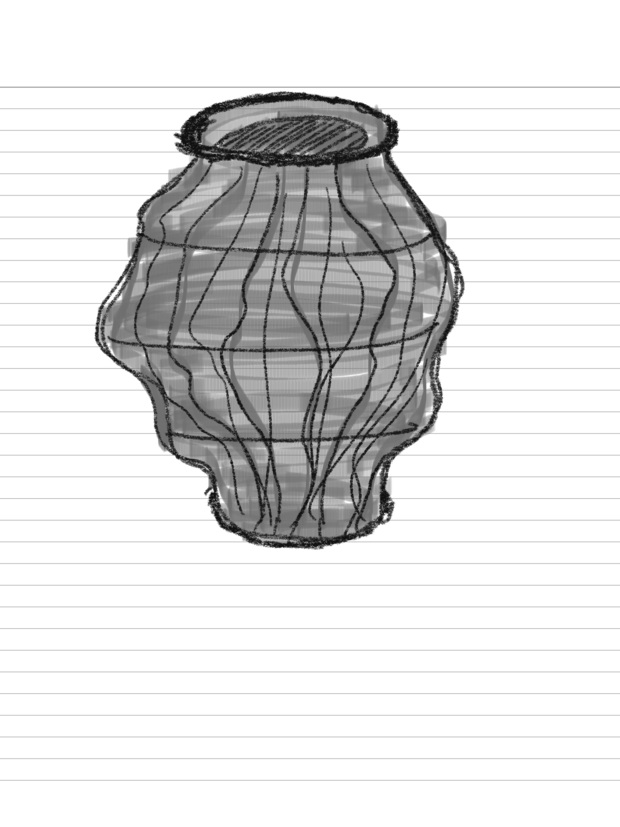
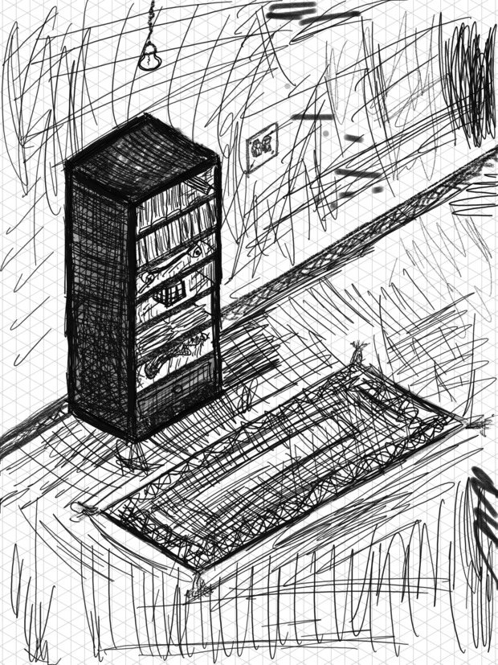
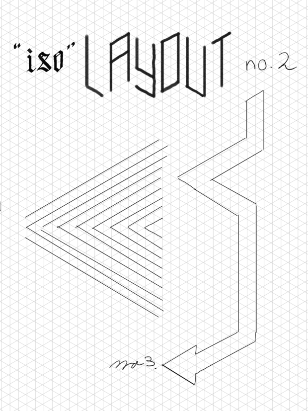
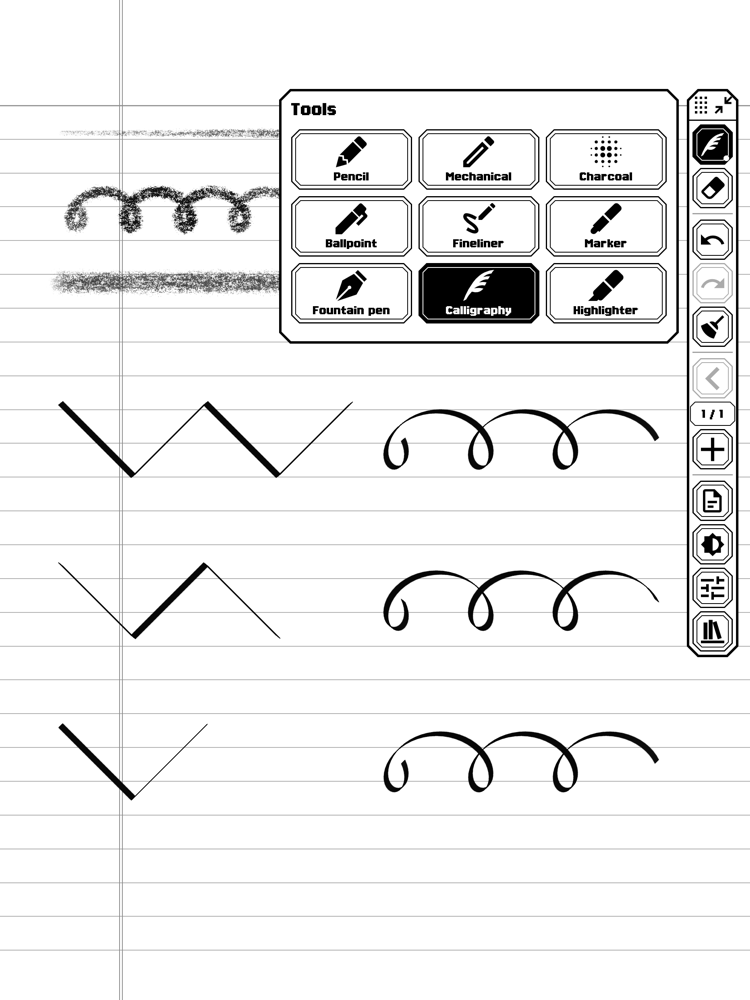
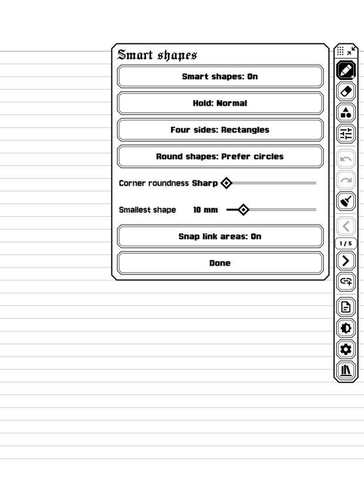
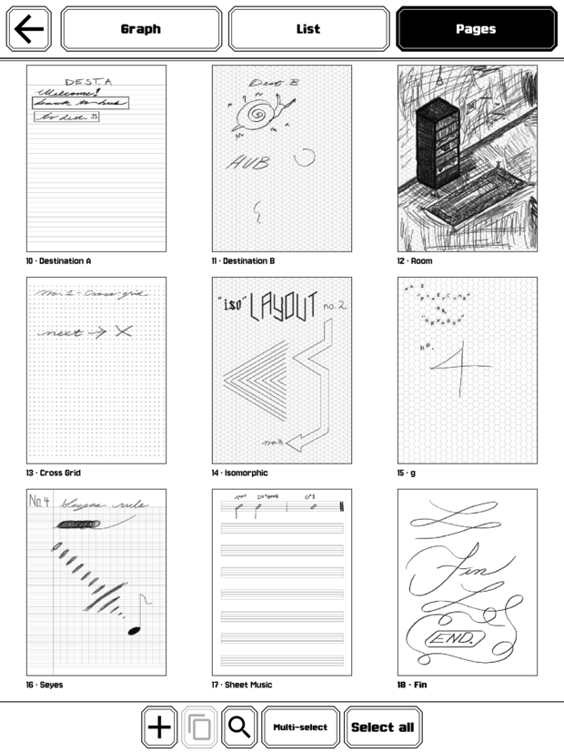
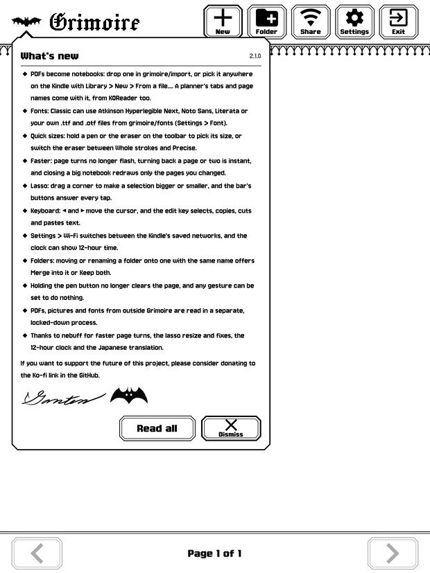
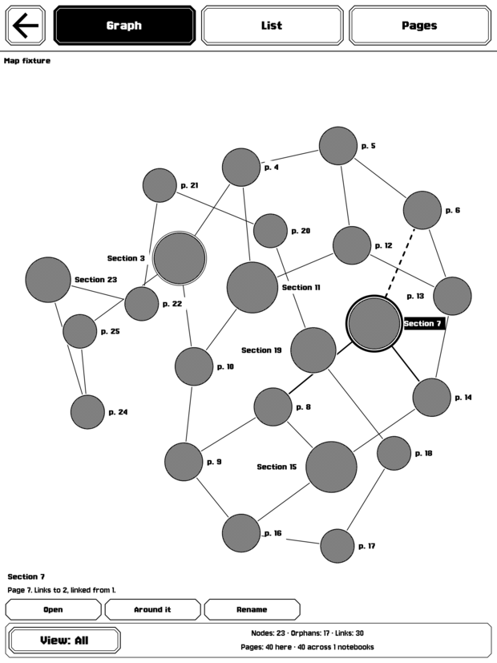
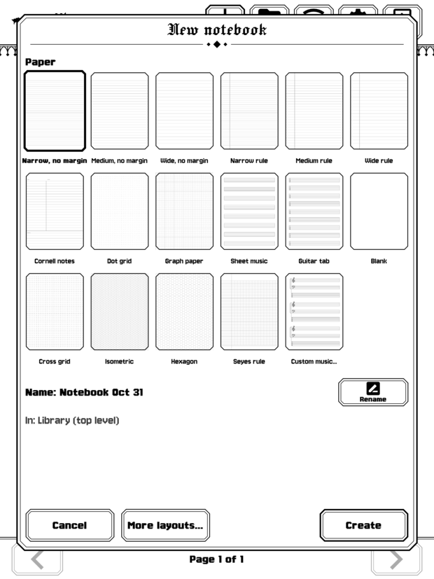
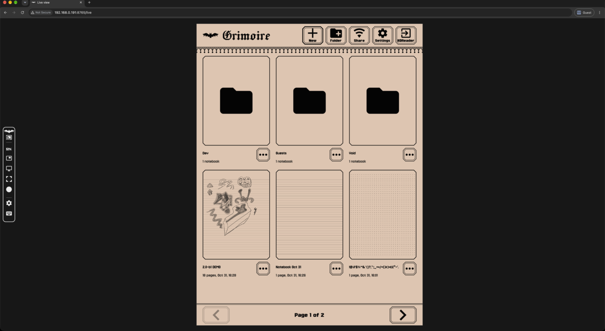

  <a href="README.md">English</a> | <a href="README-ja.md">日本語</a> | <strong>Polski</strong> | <em>Więcej języków wkrótce</em>

<h1 align="center">
  <picture>
    <source media="(prefers-color-scheme: dark)" srcset="docs/logo-dark.png">
    
  </picture>
</h1>

**Notatnik do pisania odręcznego dla Kindla Scribe z jailbreakiem.** Papier w linie, w kropki,
w kratkę i w układzie Cornella, nuty oraz tabulaturę gitarową lub basową możesz dowolnie łączyć
i nakładać; do tego dziewięć piór dostrojonych do nacisku i pochylenia rysika Scribe, foldery
oraz trzy proste sposoby przeniesienia stron na komputer w formacie PDF lub PNG. Wszystko zostaje
na Kindle w otwartych plikach: bez konta, bez chmury, bez śledzenia.

Wygląda jak zamek z dawnej gry konsolowej: pikselowe tytuły w stylu blackletter, pikselowa
czcionka, ramy z rzeźbionego kamienia i ostrołuki (prosty styl **Classic** włączysz jednym
dotknięciem w Ustawieniach).

Wolne oprogramowanie na licencji GPL-3.0. Projekt niezależny: nie jest powiązany z Amazonem
ani przez Amazon firmowany.

Strony powyżej narysowano na Kindle Scribe w Grimoire; ostatni obraz to Podgląd na żywo: ekran
Kindla w przeglądarce komputera w trakcie pisania.

## Dlaczego Grimoire

- **Twoje, na twoim Kindle.** Notatniki są otwartymi plikami w folderze `grimoire`, a nie usługą.
  Bez konta, chmury i śledzenia; nie ma się do czego logować.
- **Papier dopasowuje się do strony, a nie odwrotnie.** Linie, Cornell, siatka kropek, kratka,
  nuty, tabulatura, izometria, sześciokąty, Seyes i własne nuty: łącz je, nakładaj i nadaj każdej
  stronie własny zestaw.
- **Pióra zachowują się jak pióra.** Nacisk i pochylenie są dostrojone do Scribe, od ziarnistego
  węgla po szeroką stalówkę kaligraficzną, z białym tuszem, precyzyjną gumką i piórami, które
  można przypiąć.
- **Twoją pracę możesz wydobyć.** Udostępnianie przez Wi-Fi, lustrzane PDF-y przez USB albo
  `tools/grimoire-pull`; ten sam renderer sprawia, że strona wygląda tak samo na Kindle, w PNG
  i w PDF.
- **To wolne oprogramowanie.** GPL-3.0, stworzone do forkowania, tłumaczenia i codziennego
  użytku.

## Wspieraj Grimoire

Grimoire jest darmowy, otwartoźródłowy i tworzony przez jedną osobę z dużą starannością. Jeśli
zasłużył na miejsce w twoim notatniku, możesz wesprzeć jego rozwój na Ko-fi:

Opinie i propozycje funkcji są mile widziane również w zgłoszeniach.

## Czy zadziała na moim Kindle?

Potrzebujesz **Kindle Scribe** z jailbreakiem, który uruchamia skryplety (pliki `.sh` uruchamiane
dotknięciem w Bibliotece). Wszystkie obecne jailbreaki dla Scribe (Vera, SpiderCat, WinterBreak,
Sanctuary) to obsługują; jak wykonać jailbreak, przeczytasz na
[kindlemodding.org](https://kindlemodding.org). W przypadku starszego jailbreaka bez skrypletów
Grimoire możesz otworzyć przez KOReader (patrz tabela).

| Kindle | Stan |
|---|---|
| Kindle Scribe (2024, 2. generacja), firmware 5.17–5.20.1 | **Działa.** Używany codziennie na 5.20.1.0.2; działa też na 5.20.1 (Vera) |
| Kindle Scribe (2022, 1. generacja), firmware 5.16.3 lub nowszy | **Działa.** Używany codziennie na 5.20.1.0.2; działa też na 5.20.1 (Vera). Jeśli ekran jest do góry nogami, zobacz [Rozwiązywanie problemów](https://github.com/ganten1998/grimoire-scribe/wiki/Troubleshooting). |
| Kindle Scribe (2022) z firmwarem starszym niż 5.16.3 | Powinien działać, ale dla tych starszych jailbreaków nie ma jeszcze launchera w Bibliotece. Z KOReaderem powinien otwierać się z Tools > Grimoire po ręcznym skopiowaniu wtyczki (zobacz [KOReader](https://github.com/ganten1998/grimoire-scribe/wiki/KOReader)). |
| Kindle Scribe 3 i Scribe Colorsoft (2025) | **Nietestowane.** Nie ma jeszcze publicznego jailbreaka. Grimoire zna już ich większy ekran (1986x2648): notatniki zachowują rozmiar strony między nimi a starszymi modelami Scribe (zobacz [Przenoszenie między wersjami](https://github.com/ganten1998/grimoire-scribe/wiki/Troubleshooting#moving-between-versions)). Na kolorowym ekranie Colorsoft, po każdym szybkim odświeżeniu, Grimoire czeka, aż sterownik je odczyta; wyjątkiem jest tusz samego pióra (pisanie nigdy nie czeka), więc przyciski nie powinny wyglądać na prążkowane. |
| Paperwhite, Oasis, Basic i inne Kindle bez rysika | Nieprzydatny: bez rysika nie da się pisać. |

Najnowszy firmware to 5.20.1 (stan na październik 2026). Przed aktualizacją sprawdź, czy twój
jailbreak go przetrwa; większość osób blokuje aktualizacje OTA.

## Dokumentacja

Pełny podręcznik znajduje się w wiki, po **angielsku** i **japońsku**:

- [Angielska wiki](https://github.com/ganten1998/grimoire-scribe/wiki/Home)
- [Japońska wiki](https://github.com/ganten1998/grimoire-scribe/wiki/Home-ja)

| Strona | Czego dotyczy |
|---|---|
| [Instalacja](https://github.com/ganten1998/grimoire-scribe/wiki/Install) | Wymagania, archiwum ZIP wydania, KPM, aktualizacja i odinstalowanie |
| [Korzystanie z Grimoire](https://github.com/ganten1998/grimoire-scribe/wiki/Using-Grimoire) | Biblioteka, papier, pióra, pasek narzędzi, Indeks, linki, Podgląd na żywo, Wi-Fi, uśpienie i kod dostępu |
| [Czcionki i język](https://github.com/ganten1998/grimoire-scribe/wiki/Fonts-and-Language) | Angielski, hiszpański, japoński i polski, czcionki Classic oraz własne czcionki |
| [Importowanie](https://github.com/ganten1998/grimoire-scribe/wiki/Importing) | Szablony, zdjęcia, PDF-y i strony, które już masz |
| [Przenoszenie stron z Kindla](https://github.com/ganten1998/grimoire-scribe/wiki/Exporting) | Udostępnianie przez Wi-Fi, Efekty, PDF-y przez USB i SSH |
| [KOReader](https://github.com/ganten1998/grimoire-scribe/wiki/KOReader) | Otwieranie Grimoire z KOReadera, robienie notatek w książkach i opcjonalna wtyczka |
| [Skróty](https://github.com/ganten1998/grimoire-scribe/wiki/Shortcuts) | Klawiatury i kontrolery oraz `shortcuts.ini` |
| [Rozwiązywanie problemów](https://github.com/ganten1998/grimoire-scribe/wiki/Troubleshooting) | Znane problemy, typowe poprawki i przenoszenie między wersjami |
| [Prywatność](https://github.com/ganten1998/grimoire-scribe/wiki/Privacy) | Co zostaje na Kindle i co ujawnia Udostępnianie |
| [Współtworzenie](https://github.com/ganten1998/grimoire-scribe/wiki/Contributing) | Błędy, propozycje funkcji, pull requesty, korzystanie z LLM i wiki |
| [Budowanie ze źródeł](https://github.com/ganten1998/grimoire-scribe/wiki/Building-from-Source) | Zestawy narzędzi, cele make i testy |
| [Tłumaczenie](https://github.com/ganten1998/grimoire-scribe/wiki/Translating) | Ulepszanie hiszpańskiego, japońskiego i polskiego oraz dodawanie nowego języka |

Źródła stron wiki znajdują się w [`docs/wiki/`](docs/wiki).

## Licencja i podziękowania

Grimoire to wolne oprogramowanie: GPL-3.0-or-later (zobacz `LICENSE`), ta sama licencja co
[FBInk](https://github.com/NiLuJe/FBInk) autorstwa NiLuJe, którego Grimoire używa do sterowania
ekranem e-ink. Wiele z tego, co Grimoire wie o Kindle, pochodzi z
[KOReader](https://koreader.rocks) i [kindlemodding.org](https://kindlemodding.org).

Dołączone czcionki i inne komponenty wraz z licencjami wymieniono w
[`assets/README.md`](assets/README.md); te informacje, GPL oraz podziękowania dla FBInk są
również dołączone do aplikacji, w `grimoire/app/licenses` na Kindle.

Kindle i Kindle Scribe są znakami towarowymi Amazon.com, Inc. lub jego spółek zależnych.
Grimoire jest niezależnym projektem i nie jest powiązany z Amazonem ani przez Amazon firmowany
czy wspierany.

## Nazwa, logo i forki

Grimoire to wolne oprogramowanie i możesz go forkować na licencji GPL. Nazwa „Grimoire” oraz
logo nietoperza identyfikują jednak oficjalne kompilacje i nie wchodzą w zakres licencji GPL:
jeśli rozpowszechniasz kompilacje zmodyfikowanej wersji, nadaj jej inną nazwę i inną ikonę, nie
używaj logo nietoperza ani tutejszych zrzutów ekranu do jej prezentacji i nie przedstawiaj jej
jako oficjalnej aplikacji ani nie sugeruj, że projekt ją popiera.

Oficjalne kompilacje pochodzą wyłącznie z wydań na github.com/ganten1998/grimoire-scribe
i codeberg.org/ganten1998/grimoire-scribe oraz z kanałów KPM projektu. Wbudowany aktualizator
Grimoire śledzi te kanały.

Wkład jest mile widziany: zobacz stronę
[Współtworzenie](https://github.com/ganten1998/grimoire-scribe/wiki/Contributing), a przy
większej zmianie najpierw otwórz zgłoszenie, abyśmy mogli uzgodnić jej kształt.
