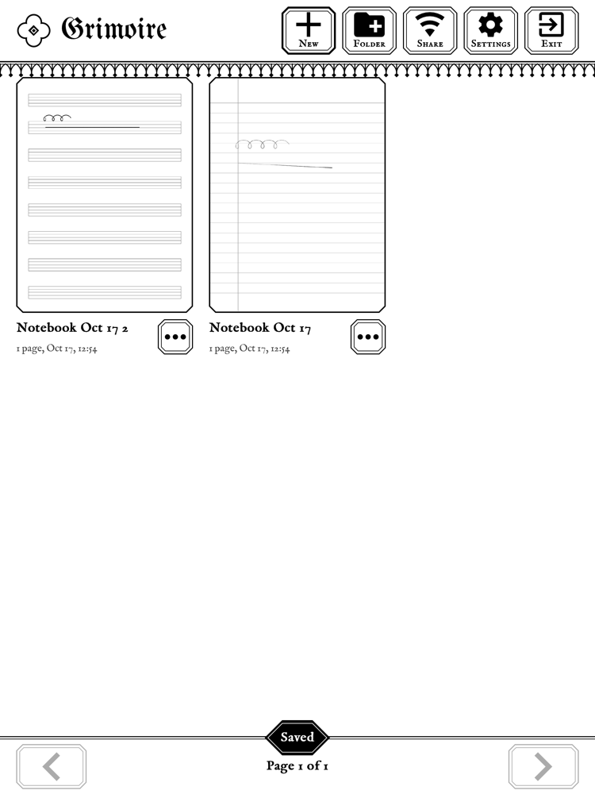
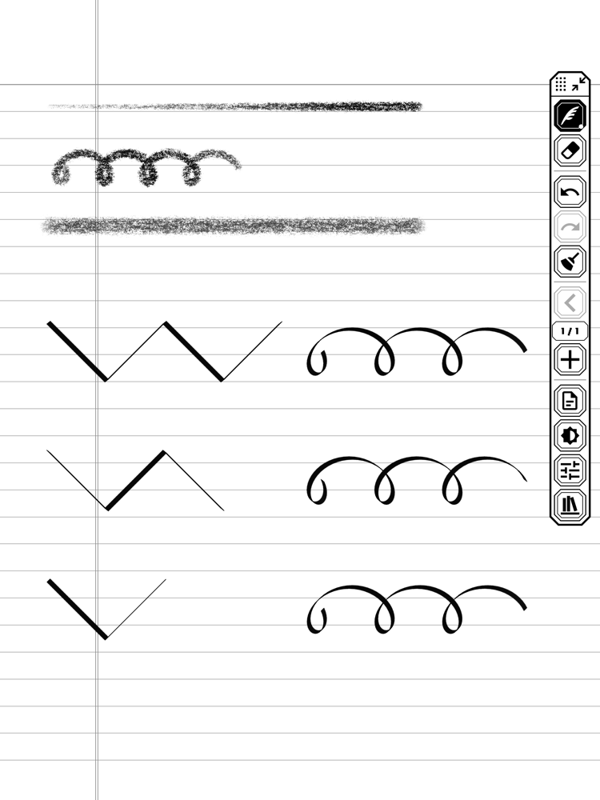
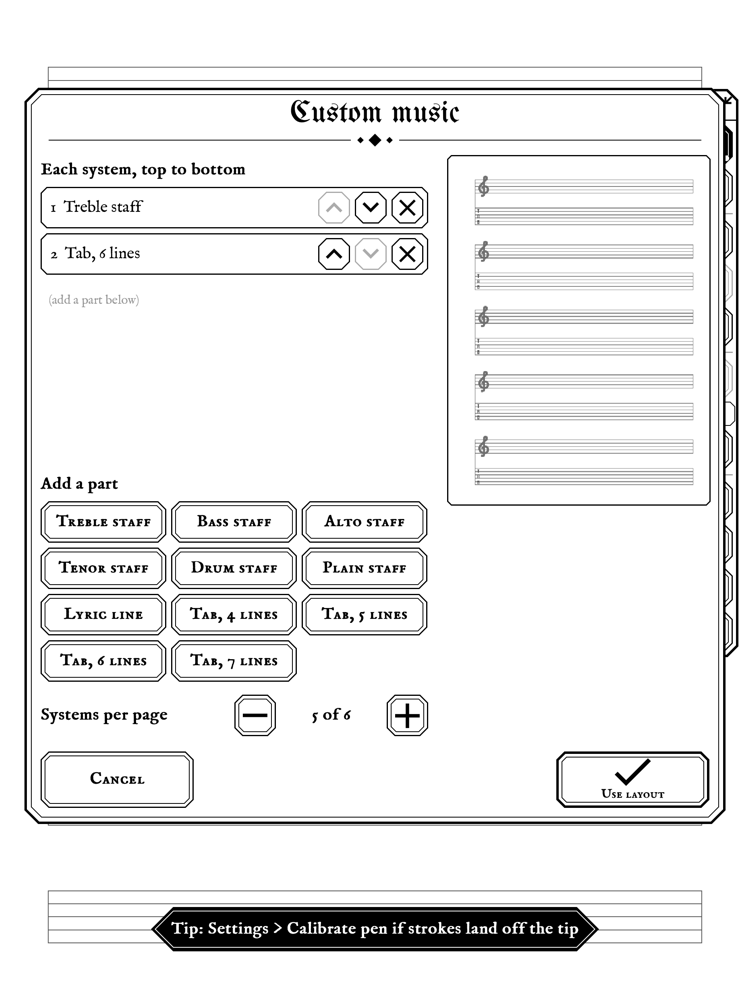

<h1 align="center">
  <picture>
    <source media="(prefers-color-scheme: dark)" srcset="docs/logo-dark.png">
    
  </picture>
</h1>

**A handwriting notebook for the jailbroken Kindle Scribe.** Lined, dotted, graph and Cornell
paper, sheet music and guitar or bass tab you can mix and stack yourself, nine pens tuned to the
Scribe's pressure and tilt, folders, and three easy ways to get your pages onto a computer as PDF
or PNG. Everything stays on the Kindle in open files: no account, no cloud, no tracking.

It comes dressed like a castle in an old console game: pixel blackletter titles, pixel type,
carved-stone frames and pointed arches
(a plain **Classic** style is one tap away in Settings).

Free software under the GPL-3.0. Not affiliated with or endorsed by Amazon.

<p>



</p>

> **Development build.** This branch is preparing 2.0.0-beta.2. Grimoire is in daily use on
> one Kindle Scribe (2024), and testers run it on theirs. It autosaves every stroke and keeps
> damaged files instead of overwriting them, but treat it as a beta: copy your notebooks off now
> and then (Library > Share makes that one click).

## Will it run on my Kindle?

You need a **Kindle Scribe** with a jailbreak that runs scriptlets (`.sh` files tapped from the
Library). Current jailbreaks for the Scribe (Vera, SpiderCat, WinterBreak, Sanctuary) all do;
see [kindlemodding.org](https://kindlemodding.org) to jailbreak. On an older jailbreak that runs
no scriptlets, KOReader can open Grimoire instead (see the table).

| Kindle | Status |
|---|---|
| Kindle Scribe (2024, 2nd gen), firmware 5.17 to 5.20.1 | **Works.** Tested daily on 5.20.1.0.2; a tester runs it on 5.20.1 (Vera). |
| Kindle Scribe (2022, 1st gen), firmware 5.16.3 or newer | **Reported working**: a tester runs it on 5.20.1 (Vera). Same platform. If the screen is upside down, see Troubleshooting. |
| Kindle Scribe (2022) on firmware older than 5.16.3 | Should run, but there is no Library launcher for those older jailbreaks yet. With KOReader, it should open from KOReader's Tools > Grimoire, the plugin copied in by hand (see Does it work in KOReader?). |
| Kindle Scribe 3 and Scribe Colorsoft (2025) | **Untested.** No public jailbreak yet. Grimoire already knows their bigger screen (1986x2648): notebooks keep their page size between these and the older Scribes (see Moving between versions). On the Colorsoft's color screen, Grimoire waits after each quick update until the screen's driver has read it, except for the pen's own ink (writing never waits), so buttons should not show striped. |
| Paperwhite, Oasis, Basic and other Kindles without a pen | Not useful: you cannot write without the pen. |

Firmware 5.20.1 is the newest as of October 2026. Check that your jailbreak survives it before
updating; most people keep OTA updates blocked.

## Install

The release also includes a KPM package for `kindlehf` Scribes. See [KPM installation and release pipeline](docs/KPM.md) for local installation, data preservation and preview/stable feeds.

1. Download `Grimoire-<version>.zip` from the
   [Releases](https://github.com/ganten1998/grimoire-scribe/releases) page and unzip it. You get a `documents` folder with two files
   (optional KOReader plugin and patches folders for manual installation: see Does
   it work in KOReader?).
2. Connect the Kindle to your computer. The Scribe uses MTP: on a Mac, use
   [OpenMTP](https://openmtp.ganeshrvel.com) (or `brew install --cask openmtp`); on Windows and
   Linux it shows up as a device.
3. Copy **both files** into the Kindle's `documents` folder:
   - `Grimoire.sh`, the app (it carries everything inside it)
   - `Grimoire - reset pen calibration.sh`, a rescue switch you will hopefully never need
4. Eject the Kindle. **Grimoire** appears in your Library with a gothic cover (indexing can take
   a minute). Tap it.

The first launch takes a few seconds while it unpacks itself into a `grimoire` folder. To
**update**, copy the new `Grimoire.sh` over the old one; your notebooks and settings stay. Going
back to an older version works the same way (see Moving between versions).

**Coming from Quire** (Grimoire's old name)? Copy the new files and tap Grimoire once. It moves
your notebooks and settings from `quire/` to `grimoire/` and removes the old Quire launcher.

## Using it

- **Library**: notebooks as covers with thumbnails, one level of folders. Tap the `...` on a
  notebook to rename, move or delete it (deleted notebooks go to `grimoire/trash`, nothing is
  ever erased outright).
- **Names** can have accents: the keyboard's **áé** key opens a page of accented letters (enough
  for Spanish, Portuguese, French, Italian, German, Dutch, Catalan, Danish, Norwegian, Swedish and
  Finnish). Shift gives capitals and **abc** returns to the letters. With Grimoire in Spanish, the
  letters page has **ñ** too, after l.
- **Paper**: narrow, medium and wide rule (with or without margin), Cornell, dot grid, graph,
  blank, sheet music, grand staff, guitar tab, 4 to 7 string bass tab, and **Custom music**:
  stack treble, bass, alto, tenor, drum and plain staves, tabs and lyric lines, and choose how
  many systems fit on a page. Each page can have its own paper.
- **Pens**: pencil, mechanical pencil, charcoal, ballpoint, fineliner, marker, fountain pen,
  calligraphy pen, highlighter. Every pen's pressure and tilt response can be tuned
  (Settings > Pen sensitivity). The eraser takes away whole strokes, or set to **Precise** only
  what it touches (see White ink, pinned pens and templates); the eraser end of the Premium Pen
  works too.
  - **Charcoal** is grainy and crumbly, darker the harder you press; lay the pen low and it
    shades broad and soft with the side of the stick.
  - **The calligraphy pen** is a broad-edge nib that sits at 90 degrees to the way the pen
    leans, like a real one: lean toward the bottom right (a right hand) and you get the classic
    45 degree italic, thick going down to the right and hairline going up; lean toward the bottom
    left (a left hand) and the nib mirrors. Hold the pen upright and it keeps the 45 degree nib.
- **The floating panel** holds tools, undo/redo, clear page, pages, paper and the Library. Drag
  it anywhere; tap the corner arrows to fold it into a small box.
- **Pen button**: hold it to highlight (or erase; Settings), click it three times to clear the page.
- **Pages**: tap the page counter for a fast numbered grid, or **Go to page...** for a number pad.
  The grid reads no other pages. Tap a tile to open it, or tick pages and delete them.
  **New page** inserts a blank note after the open page or the last ticked page. Tick one page
  and choose **Copy page** to duplicate its ink and paper right after it. Annotated book pages
  show their source page number under the tile.
  A page made by a newer Grimoire opens read-only (see Moving between versions).
- **Pinch** to zoom up to 4x. Grimoire turns with the Kindle (switchable).
- **Sleep**: the power button sleeps the Kindle *inside* Grimoire, showing your page (or a pinned
  page, or the Kindle's own screensaver). Waking brings you straight back.
- **Leaving**: **Library > Exit**, or hold the power button 4 seconds on any screen, asleep or
  awake. Grimoire saves your page and closes, and the Kindle comes back. If the page cannot be
  saved (the Kindle's storage is full), a hold while awake says so and stays; hold again within a
  minute to leave without it. Opened from KOReader, Exit reads **Back to KOReader**, and both ways
  out take you back to KOReader.
- **Passcode**: started from the Kindle Library, Grimoire leaves your Device Passcode on. When
  the Kindle goes to sleep, Grimoire saves your page and hands the screen and touch input to the
  Kindle, so its own keypad can ask for the passcode; when the Kindle reports the unlock, Grimoire
  takes them back and shows your notebook. With a passcode set, the keypad comes before a custom
  sleep picture, and the Kindle interface keeps running for it. Confirmed upright and sideways on
  the Scribe 2024 with firmware 5.20.1.0.2; other firmware still needs a check. KOReader normally turns the
  passcode off for its whole session, and Grimoire opened from KOReader leaves it that way. Start
  Grimoire from the Library when you need the passcode.
- **Language**: English or Spanish, following the Kindle's own language (see Language).

## White ink, pinned pens and templates

- **White ink**: tap the pen button on the panel; the picker's bottom row is **Black | White**.
  With White, every pen draws white with its own texture, taking ink away while the paper's lines
  stay. The pen in use shows a hollow icon while white is on.
- **The eraser**: **Pen feel > the eraser's tab > Eraser** is **Whole strokes** (a touch takes the
  whole stroke) or **Precise** (it takes away only what it touches). Tapping the eraser again goes
  back to the pen you used before it. Library > Settings' pen-button row can also make holding the
  pen button draw white.
- **Pinned pens**: in the picker, tap **Pin**, then the pens you want on the panel (up to four),
  then Done. Each gets its own button under the pen button.
- **Templates**: copy PNG or JPG pictures into `grimoire/templates/` over USB while Grimoire is
  closed (upright, 3:4, 1860 x 2480 is best, light lines on white work best on e-ink). In a
  notebook, Paper > **More papers...** shows them; New notebook has the same tile. Each notebook
  keeps its own copy of a template it uses.
- **Pages you already have**: put a folder of page pictures (PNG or JPG, one per page, such as a
  PDF exported as pictures with `pdftoppm -gray -png -r 200 file.pdf page`) in
  `grimoire/import/<Name>/` and start Grimoire: it becomes the notebook <Name>, and the folder
  moves to `grimoire/import/done/`.
- **Erased ink leaves the files**: when a notebook closes, ink erased entirely is taken out of its
  page files in the background. A stroke erased only in part stays whole in the file.

## Language

Grimoire speaks English and Spanish. **Settings > Language** offers **Automatic**, **English** and
**Español**. Automatic, the default, follows the language set in the Kindle's own Settings, and
gives English for a language Grimoire does not speak yet; its row names the language it gives
("Automatic (English)"). So if your Kindle is set to Spanish, Grimoire is in Spanish from the
first start after you update; **Ajustes > Idioma > English** (Settings > Language, in Spanish)
switches it back. A choice applies at once and stays chosen.

All of Grimoire follows it: every screen, the share pages and the Effects studio, and the name a
new notebook gets ("Notebook Oct 20", "Cuaderno 20 oct"). Your pages never change with the
language: paper is drawn the same everywhere (Cornell notes keep their English headings), and the
names you give notebooks and folders stay as you typed them. The KOReader plugin follows
KOReader's own language.

The Spanish is a draft until a native speaker reviews it: `po/es-glossary.md` lists the choices of
words to confirm. Corrections and new languages are welcome;
[docs/TRANSLATING.md](docs/TRANSLATING.md) says how. Translations are under Grimoire's license,
GPL-3.0-or-later.

## Getting pages off the Kindle

Details in [docs/EXPORT.md](docs/EXPORT.md).

1. **Wi-Fi**: turn on Wi-Fi and open **Library > Share**. Point your phone's camera at the QR code
   it shows, or type the address under it into any browser on the same network. Download a
   notebook as PDF or zip, single pages as PNG, or everything at once. The browser reader shows
   one page at a time, with a page counter and number field at the top; type a number to jump. **Effects** makes
   transparent, recolored or filtered copies (gradient signatures, warm tones, sepia, blueprint
   and more) and shows the matching ImageMagick command. Only devices on your network can reach
   it, and only while the Share screen is open.
2. **USB**: every notebook you close is also saved as a PDF in `grimoire/PDFs/<folder>/`.
3. **SSH** (for the terminal-inclined): `tools/grimoire-pull` syncs everything and renders PDFs
   on your computer.

## Does it work in KOReader?

Yes: KOReader can open Grimoire and get you back to your book. With KOReader installed (the
Kindle's `koreader`, `extensions/koreader` or `documents/koreader` folder), open
**Grimoire > Settings > KOReader > Install / update Grimoire plugin**, then restart KOReader.
That adds **Tools > Grimoire** to its menu. A fresh Grimoire installation leaves KOReader untouched:

- **Open Grimoire**: KOReader closes and Grimoire opens in its place, without the Kindle's home
  screen in between. In Grimoire, Library > Exit reads **Back to KOReader** (**Volver a KOReader**
  in Spanish); it, or holding the power button 4 seconds, brings KOReader back with the book you
  had open (or its file browser).
- **Notebook PDFs**: KOReader's file browser in `grimoire/PDFs`.
- **Reset pen calibration**: the same rescue as the Library's reset item.

Open Grimoire is also an action for KOReader's gestures (Settings > Taps and gestures). The menu
speaks KOReader's language, English or Spanish (**Abrir Grimoire**, **PDF de los cuadernos**,
**Restablecer la calibración del lápiz**). Only a start from the Library updates the plugin, so
after you update Grimoire, tap it in the Library once.

This needs a KOReader started from its Library item or from KUAL (KOReader's `koreader.sh`
start). A KOReader launcher that leaves the Kindle interface running is supported too: Grimoire
pauses it for its own session and restores it before returning. Opened from KOReader, Grimoire cannot show the Kindle's own screensaver as its
sleep screen (that needs the Kindle's screens, which KOReader keeps paused), so it shows your page
instead. The plugin keeps KOReader's framework service alive during Grimoire on a no-framework KUAL start,
so the power service can still handle sleep.

**Library > Settings > KOReader** installs or updates the plugin, removes it, or toggles each
of the three optional patches: diagonal screenshot gestures off, square folder corners,
and Terminess menu fonts. The font patch includes the font. Restart KOReader after changing a patch
or the plugin. A different patch at the same filename is preserved; no patches are applied just
by updating Grimoire. The separate `KOReader-patches.zip` and the main zip carry the three scripts
from 1.1.0-beta.1: screenshot gestures and corners stay unchanged; Terminess now matches
regular/bold fonts and separates the dropdown battery icon from its percentage. Fonts and manual
instructions are included.

**Display > Sleep screen: KOReader wallpaper** uses a snapshot of KOReader's configured custom
image, random image or book cover, exported whenever Tools > Grimoire hands over. It also works
on a later Library start. If no custom image is available, your page shows. A random folder picks
one image per handover; KOReader's message/status widgets are not copied. With a Device Passcode
set, the passcode keypad comes first.

*Execute shell script* on `Grimoire.sh` in KOReader's file browser still refuses, because
KOReader keeps the pen and the touch screen to itself (KOReader reports status 3): use Tools >
Grimoire instead.

The plugin is optional. To remove it, delete `koreader/plugins/grimoire.koplugin`; while KOReader
stays installed, Grimoire does not put it back. To put it back, or into a KOReader installed again
since, or where the Library cannot run scriptlets, copy the zip's
`KOReader plugin (optional)/grimoire.koplugin` folder into the Kindle's `koreader/plugins` (with
`Grimoire.sh` in `documents` as usual). Never copy a folder named `koreader` onto the Kindle: it
could replace your KOReader.

The notebook PDFs in `grimoire/PDFs` open in KOReader for reading. Grimoire writes a notebook's
PDF again whenever you close the notebook after a change, and renames, moves or deletes it with
the notebook, so highlights or notes KOReader writes into that file are lost: to mark one up, copy
it out of `grimoire/PDFs` and open the copy.

**Annotate this page.** In a book in KOReader, Tools > Grimoire > **Annotate this page in
Grimoire** (also a gesture action) opens the page you are reading in Grimoire, ready to write on.
Grimoire keeps one notebook per book, named after its title (leaving out characters it cannot
show), with the pages you annotate in the book's order; annotating the same page again opens it
with what you wrote. Library > Back to KOReader returns to the same book and page. A PDF's page is
the whole page; an EPUB's is the screen as KOReader lays it out, so after a change of font size a
page may come in again as a new one. A notebook's own PDF from `grimoire/PDFs` is refused, since
annotating it would make a notebook of a notebook: open that notebook in Grimoire instead.

## Moving between versions

Updating is one file, and so is going back. From 1.1.0-beta.1 on, Grimoire keeps what a newer
version writes and does not understand (ink data, newer papers, extra page data, unknown lines
in `settings.ini` and `notebook.ini`) and writes it back unchanged:

- A page it cannot fully show opens **read-only**, with "This page was made by a newer Grimoire.
  It is read-only here." Writing, erasing, clearing and changing its paper are refused on it;
  deleting it still works. Update Grimoire to edit it.
- A paper from a newer version shows as blank paper named **Newer paper** and stays the page's
  paper. New pages added after such a page get it too.
- A setting from a newer version that this one lacks works here as the nearest choice it has
  (a switch with a third state counts as on or off), and stays in the file until you change that
  setting.
- A notebook or folder name longer than 95 bytes (about 47 accented letters) is cut to fit,
  never in the middle of an accented letter.

1.0.0-beta and 1.0.0-rc.1 cannot do this. Open a notebook there after a newer version wrote to
it, and data can be lost: they set a page in a newer format aside as
`p<id>.qpg.damaged-<time>` and show it blank (just looking at it in Pages does this), and they
drop newer data when they save. 1.1.0-beta.1 and later bring such pages back when you open the
notebook again, and keep both copies if the page was written again in the meantime; a page you
deleted in the older version stays set aside. The file format and its rules are in
[docs/FORMAT.md](docs/FORMAT.md).

**Scribes of two sizes.** The 2022 and 2024 Scribes have a 1860x2480 screen, the Scribe 3 and the
Scribe Colorsoft a bigger one, 1986x2648. From 1.1 on, a notebook keeps the page size it was made
with: on a Scribe of the other size its pages are shown fitted to the screen, the writing on its
lines, and its new pages, PDFs and PNGs have the notebook's size. A notebook from before 1.1 takes
the size most of its pages have. Your pen and touch calibration follows a `grimoire` folder copied
to a Scribe of the other size: Grimoire scales it to the new screen when it starts. Versions before
1.1 stretch every page to their own screen instead (by the 7% between the sizes, which moves the
writing off its lines, about two medium rules near the bottom of the page), and save it so once
you change that page. Back in 1.1, such a page returns to its notebook's size, which puts the
writing done in 1.1 back on its lines (ink added in the older version moves by the same ratio). So
going back to an older version on a Scribe of the other size moves the ink on every page it edits
there.

**Language.** 1.0.0-beta and 1.0.0-rc.1 forget the Settings > Language choice the next time they
save their settings, so back in 1.1 or later the language is Automatic again.

**KOReader.** An older version leaves KOReader's Grimoire plugin where it is: Tools > Grimoire
stays in KOReader, Notebook PDFs and Reset pen calibration still work, and Open Grimoire says
"This Grimoire cannot open from KOReader", because a `Grimoire.sh` older than 1.1 cannot be opened
from KOReader. Back in 1.1, Open Grimoire works again. To take the plugin out in the meantime,
delete `koreader/plugins/grimoire.koplugin`; to have it again in 1.1, copy it in by hand (see Does
it work in KOReader?).

**Pictures as paper.** In 1.0.0-beta a page on a template, an imported page or an annotated
page shows blank paper, with its ink. Back in 1.1, those pages get their pictures back when the
notebook opens. Older versions also show erased ink again, as they do not know white ink or the
precise eraser, and they drop pinned pens from `settings.ini`.

## Privacy

- **The Device Passcode stays on for a Library start.** Grimoire never reads or stores your
  passcode: the Kindle's own keypad takes it, and Grimoire logs no input while the keypad has the
  screen. This hand-over still needs confirmation on each firmware, and KOReader's own session can
  have turned the passcode off; see Passcode above.
- **Erased ink.** Fully erased strokes are removed by background compaction after a notebook
  closes. A partially erased stroke remains whole in the raw page file; old exporters can show
  its erased parts. Deleted pages and notebooks stay in `grimoire/trash` until you remove them.

- **Share has no password.** Anyone on the same network can open it while the Share screen is
  open, and nobody once you leave it. Do not open Share on a network you do not trust.
- **grimoire.log**, which a bug report asks for, holds no serial number, account, Wi-Fi name or
  network address, and Share notes downloads without notebook or folder names.

## Known issues

- **KOReader's first screen can be incomplete on firmware 5.20.1.** KOReader can draw its first
  screen with parts missing, also when it comes back from Grimoire. This is a KOReader issue
  ([koreader issue 16283](https://github.com/koreader/koreader/issues/16283)), and Grimoire does
  not fix it.

## Troubleshooting

- **Stuck?** Hold the power button 4 seconds. Grimoire saves your page and closes, and the Kindle
  comes back. If even that does nothing, hold it until the Kindle restarts (about 40 seconds); a
  restart keeps your notebooks. Never use the passcode reset code 111222777 to get out of
  anything: it erases the Kindle, notebooks included.
- **"Your Kindle passcode was left off"**: the Kindle restarted while Grimoire was open. Turn the
  passcode back on in the Kindle's Settings (Device Options > Device Passcode); Grimoire leaves
  that to you.
- **"This page was made by a newer Grimoire. It is read-only here."**: update Grimoire to change
  that page. Nothing on it is lost (see Moving between versions).
- **KOReader**: open Grimoire from KOReader with Tools > Grimoire, never with *Execute shell
  script* (see Does it work in KOReader?). If "Grimoire did not start: KOReader is running." shows
  near the top of the screen after you tap Grimoire in the Library, a KOReader is still running in
  the background (after a crash, say): restart the Kindle.
- **KOReader says "Grimoire could not start. See grimoire/grimoire.log."**: the hand-over did not
  run Grimoire. A `grimoire.sh: not starting` line in `grimoire/grimoire.log` says why (KOReader
  had not let go of the pen and the touch screen, say), and `already running` means another
  Grimoire was still open. With neither, the hand-over failed inside KOReader: KOReader's own log,
  `koreader/crash.log`, has a line starting `Grimoire:` about it. "This Grimoire cannot open from
  KOReader" means the `Grimoire.sh` in `documents` is older than 1.1: copy a newer one.
- **Strokes land away from the pen tip**: Settings > Calibrate pen and touch. If you cannot reach
  it, tap **Grimoire - reset pen calibration** in the Library.
- **Everything is upside down** (possible on the 2022 Scribe): put an empty file named
  `screen-flip` or `screen-noflip` in the `grimoire` folder and relaunch.
- **Bits of the Kindle's own screen show through**: Grimoire repaints over them on its own. If
  it keeps happening, put an empty file named `stop-framework` in the `grimoire` folder; Grimoire
  then stops the Kindle interface completely while it runs (it takes a few seconds longer to
  come back after Exit). Opened from KOReader, the file does nothing: KOReader pauses the Kindle
  interface itself.
- **Nothing happens when you tap Grimoire**: look at `grimoire/grimoire.log`. Please attach it
  to any bug report.

## Keyboard and controller shortcuts

In **Library > Settings > Shortcuts**, enable shortcuts to create `grimoire/shortcuts.ini`.
Edit that file and select **Reload shortcuts.ini** to customize tool switching, undo/redo, white ink
and page navigation. The sheet shows the last key/button code to help map a controller. Shortcuts
start disabled. See [the mappings and hardware limits](docs/SHORTCUTS.md).

## Uninstall

Delete `Grimoire.sh` and `Grimoire - reset pen calibration.sh` from `documents`, then the
`grimoire` folder (copy `grimoire/notebooks` or `grimoire/PDFs` somewhere first if you want to
keep your pages). With KOReader, delete `koreader/plugins/grimoire.koplugin` too.

## Building from source

Needs Zig 0.16.0 (the Kindle cross build), `clang`, Python 3.12+, and LuaJIT for patch checks.
SDL3 is needed for the desktop simulator; gettext updates translations. The release workflow
records the build/test setup.

```
make check     # unit tests, scripted UI scenarios with state checks, share server, exporter,
               # ARM build, the zip with its launchers and KOReader plugin, and every language
               # on every screen (make l10n-check)
make sim       # desktop simulator window (docs/SIM.md)
make kindle    # build/kindle/grimoire: static ARMv7 hard-float (musl) binary
make dist      # complete installable bundle in dist/Grimoire-VERSION-COMMIT/
make package   # build/dist/Grimoire.zip
make kpm-package # build/kpm/*.kpkg and preview/stable repository manifests
make tools     # build/host/grimoire-export (used by tools/grimoire-pull)
make l10n      # po/grimoire.pot from the sources, every po/<lang>.po updated and compiled
```

Use `make dist` for builds to keep or install. It collects the installer ZIP, optional KOReader
patch ZIP, KPM package and manifests, checksums, and source revision in `dist/`. Version/commit
folders keep different builds separate, and the collector refuses to overwrite different files.
`DIST=/path/to/dist` selects a shared output folder across worktrees. Build intermediates remain
under `build/`; Downloads is not a build destination. Collecting a build does not publish it.

The compiled languages (`po/*.mo`) are committed, so building needs no gettext; only `make l10n`
needs GNU gettext. [docs/DESIGN.md](docs/DESIGN.md) describes the architecture, the refresh
model, the brush model, the languages and the file formats; [docs/FORMAT.md](docs/FORMAT.md) the
files byte by byte; [docs/KINDLE.md](docs/KINDLE.md) covers how it fits into the Kindle and
KOReader; [docs/TRANSLATING.md](docs/TRANSLATING.md) how to improve a translation or add one.

## License and credits

Grimoire is free software: GPL-3.0-or-later (see `LICENSE`), the same license as
[FBInk](https://github.com/NiLuJe/FBInk) by NiLuJe, which it uses to drive the e-ink screen.
Much of what Grimoire knows about the Kindle comes from [KOReader](https://koreader.rocks) and
[kindlemodding.org](https://kindlemodding.org).

- Terminess Nerd Font, Jacquard 24 and Jersey 10: SIL Open Font License 1.1
  (`assets/*-OFL-1.1.txt`)
- stb_truetype and stb_image_write by Sean Barrett: public domain / MIT
- QR Code generator by Project Nayuki: MIT, vendored unmodified in `third_party/qrcodegen`
  (upstream commit 3c6d0b3)
- Inside FBInk: cutef8 by Jeff Bezanson (public domain) and Bjoern Hoehrmann's UTF-8 decoder
  (ISC, as FBInk's credits give it)
- musl libc and zig's compiler-rt: MIT (the Kindle binary is linked statically against them)

These notices, the GPL and FBInk's credits ship inside the app too, in `grimoire/app/licenses`
on the Kindle.

Kindle and Kindle Scribe are trademarks of Amazon.com, Inc. or its affiliates. Grimoire is an
independent project and is not affiliated with, endorsed by or supported by Amazon.

For the proposed selection-annotation and wireless Emacs/org-roam bridge, see
[the source investigation and integration design](docs/INTEGRATIONS.md). These are future work.
