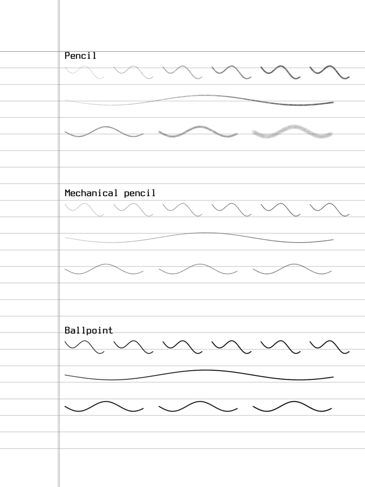

# Quire

A homebrew notebook for the jailbroken **Kindle Scribe 2** (2024): narrow, medium and wide
rule plus sheet music, a library of notebooks and folders, three pens tuned for the Scribe's
pressure + tilt digitizer, a floating tool panel, and three easy ways to get pages onto a
computer. One static binary, launched from a Library scriptlet. Typeset in Terminess.



## What it does

- **Paper**: narrow (5.5 mm), medium (7.1 mm), wide (9 mm) rule, each with or without the
  margin line, roomy 8-staff sheet music, blank. Each page can change paper on its own (undoable).
- **Library**: notebooks as cards with thumbnails, one level of folders, rename / move / delete
  (delete goes to `quire/trash`, never unlinked). Notebooks reopen on the page you left.
- **Pens**: pencil (graphite with paper grain, shades when tilted), mechanical pencil (thin,
  even), ballpoint (solid, quick to full ink), highlighter (broad gray that never hides the
  writing). The eraser removes whole strokes; the Premium Pen's eraser end erases with any tool.
- **Pen button**: hold it while writing to highlight (or erase, in Settings); click it 3 times,
  or hold it about a second without touching the screen, to clear the page. The toolbar's broom clears too.
- **Display**: the Kindle's front light brightness and warmth (system levels 0..24, the same
  ones the stock UI uses), and an invert option that shows Quire white on black.
- **Zoom and rotation**: pinch with two fingers to zoom 1x..4x and pan; a chip resets to 100%.
  Quire turns with the Kindle (portrait, upside down, both landscapes; can be switched off). Strokes keep the settings they were
  drawn with, so retuning a pen never changes old pages.
- **Pen feel**: per tool, 13 sliders: min/max width, light/full darkness, pressure deadzone,
  "full at" and curve, tilt start/full, how much tilt widens and lightens, grain, smoothing.
  A live pressure-curve graph, raw-to-mapped readout and a scratch pad to try them.
- **Floating panel**: drag it anywhere by its grip; tap the corner arrows to collapse it into a
  small box showing the current tool, tap the box to expand, drag the box too. Holds the tools,
  undo / redo, prev / page count / next (or new page), paper, pen feel, library.
- **Getting pages off the Kindle** (see [docs/EXPORT.md](docs/EXPORT.md)):
  1. *Wi-Fi*: Library > Share shows `http://<kindle-ip>:8765`; open it in any browser for
     PNG pages, PDF / zip notebooks, folder and everything zips.
  2. *SSH*: `tools/quire-pull` rsyncs and renders PDFs on the Mac with the same renderer.
  3. *USB*: closing a notebook writes its PDF to `documents/Quire/<folder>/`.

## Install

See [docs/KINDLE.md](docs/KINDLE.md). Short version: `make package`, unzip `build/dist/Quire.zip`,
copy the two files in `documents/` into the Kindle's `documents` folder (OpenMTP on a Mac), then
tap **Quire** in the Library. `Quire.sh` is self-contained and unpacks the app on first run.
(No KUAL: on Vera-era jailbreaks it is obsolete.)

## Build

Needs `zig` (Kindle cross build), `clang`, and SDL3 for the desktop simulator.

```
make check     # unit tests, scripted UI scenarios, share server, exporter, ARM build
make sim       # desktop simulator window (docs/SIM.md)
make kindle    # build/kindle/quire: static ARMv7 hard-float (musl) binary
make package   # build/dist/Quire.zip
make tools     # build/host/quire-export (used by tools/quire-pull)
```

## Layout

`docs/DESIGN.md` is the architecture: modules, refresh model, brush model, file formats.

## Licenses

Quire's code: unlicensed so far (your call; MIT would suit). Terminess Nerd Font: SIL OFL 1.1 (`assets/Terminess-OFL-1.1.txt`).
FBInk: GPL-3.0-or-later (linked into the Kindle binary, so that binary is GPLv3).
stb_truetype / stb_image_write: public domain / MIT.
