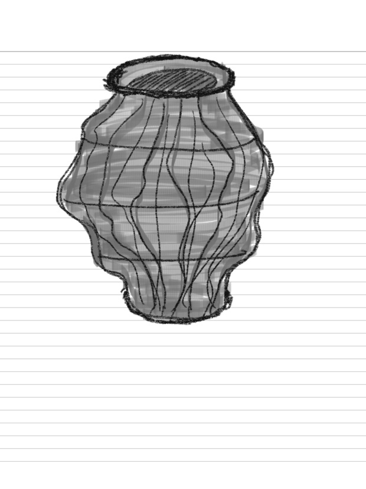
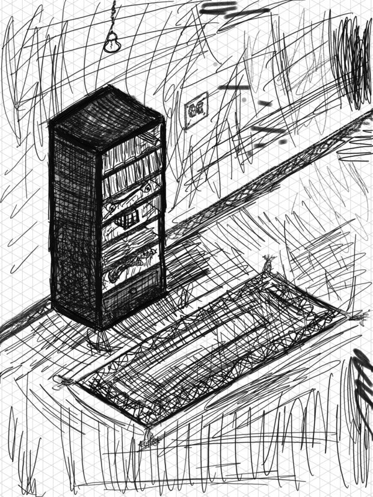
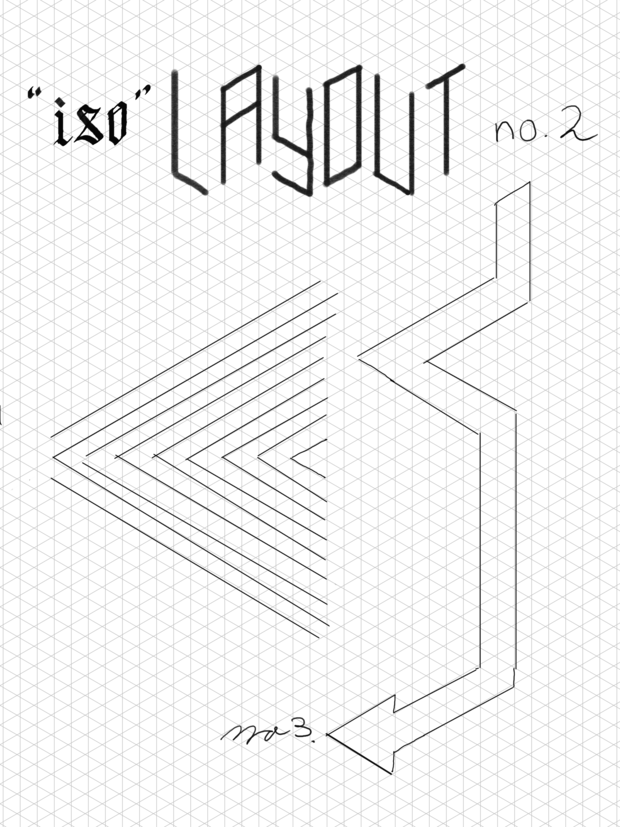
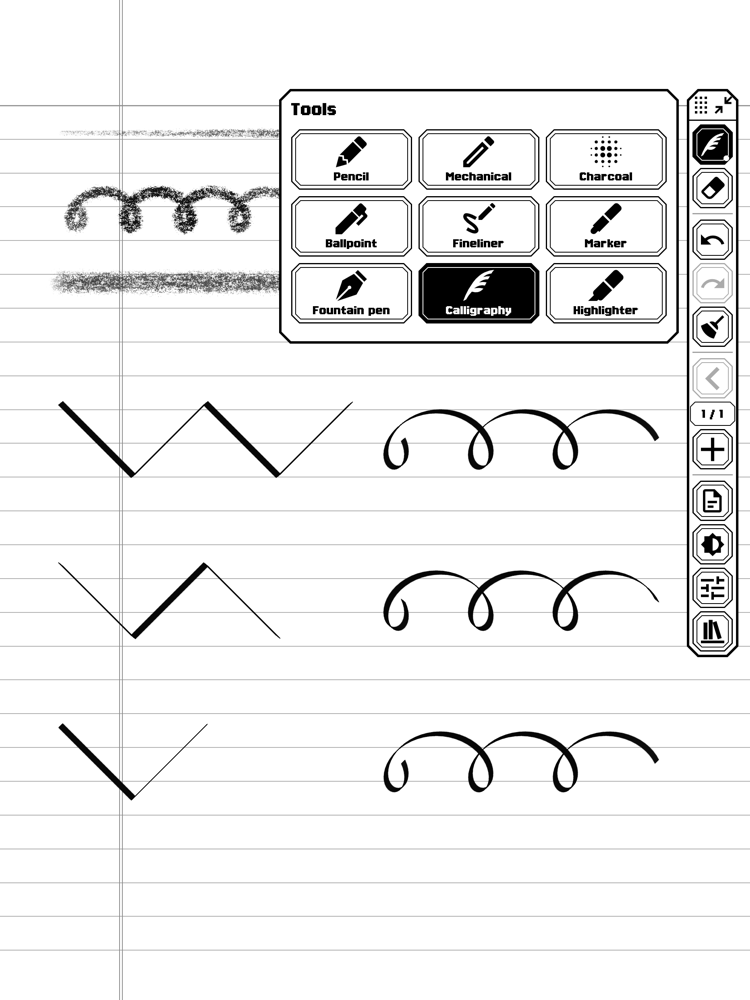
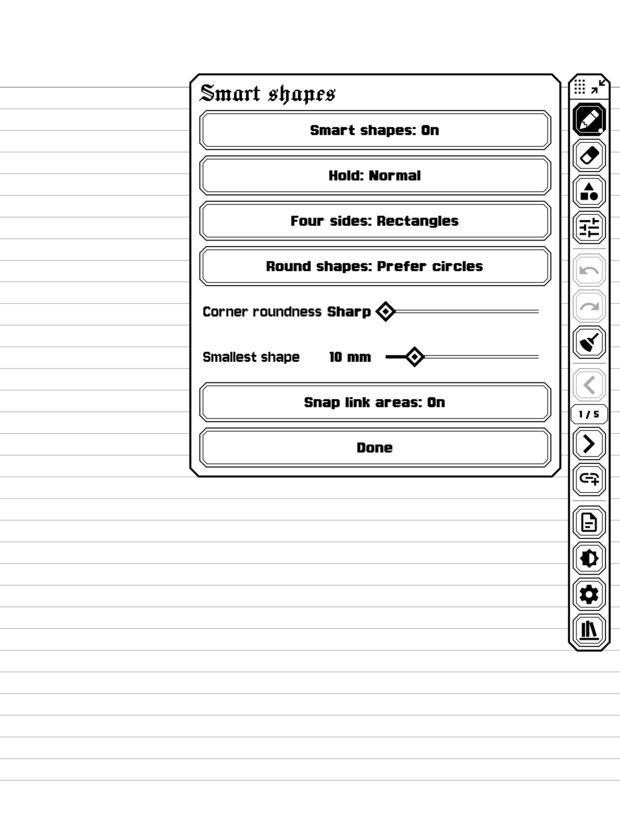
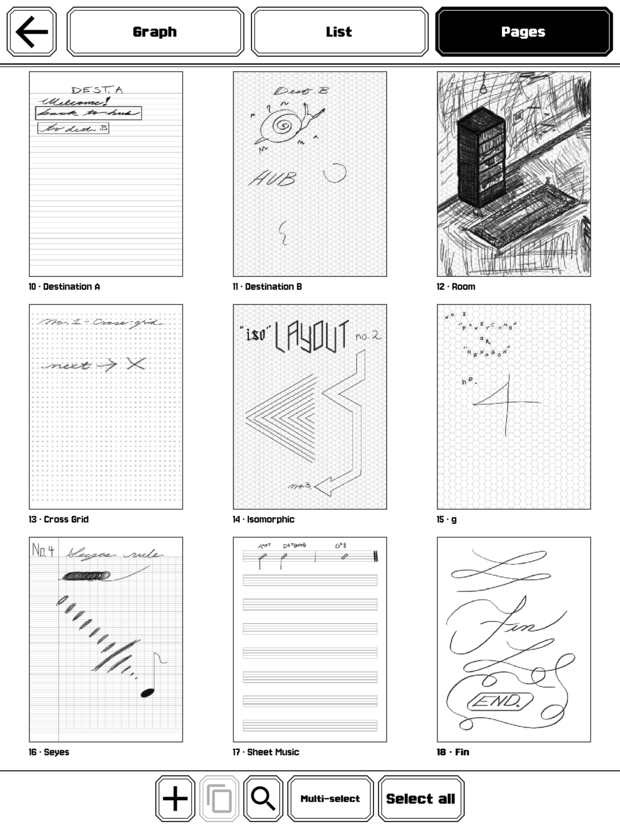
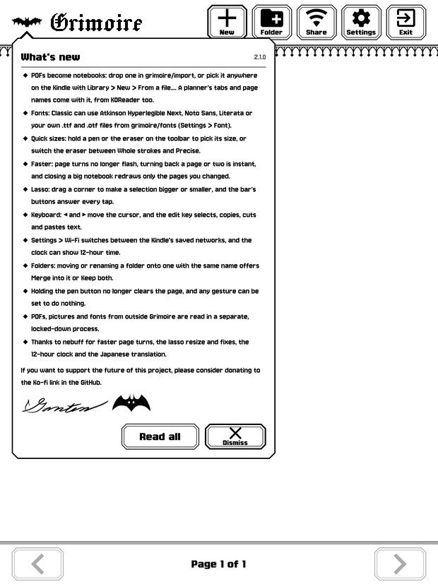
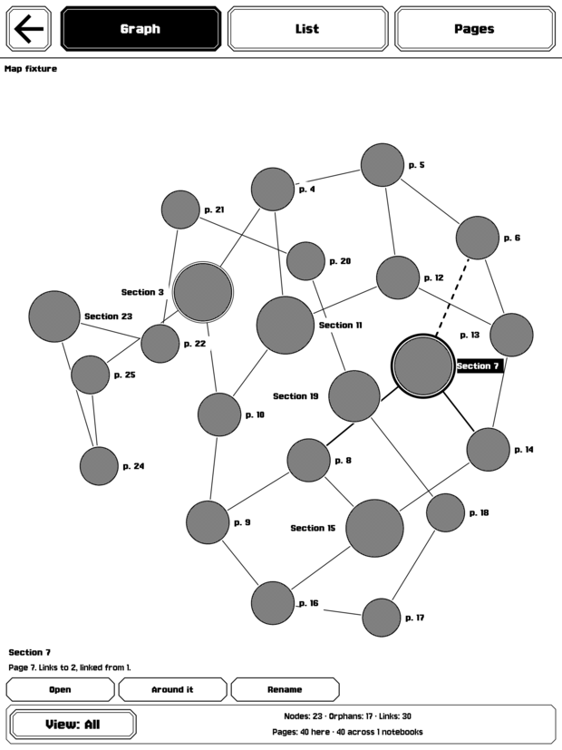
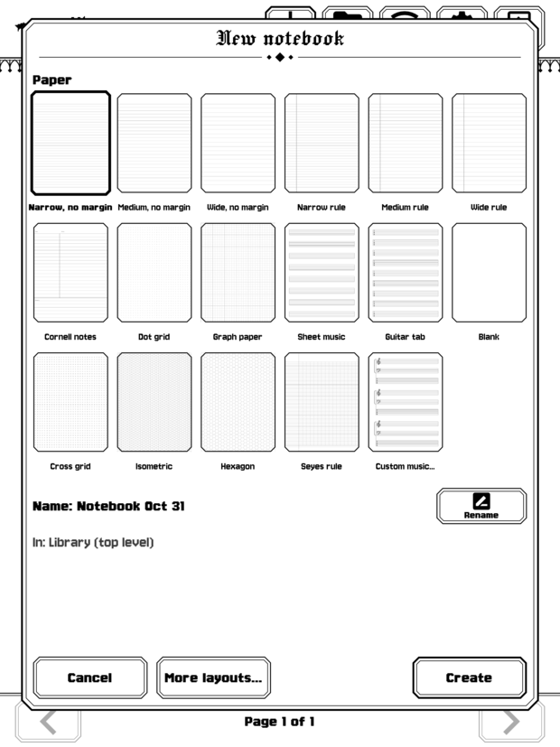
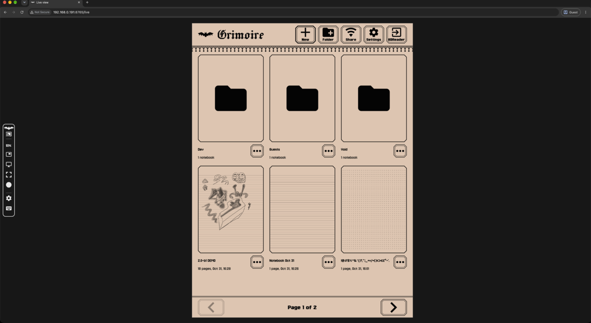

  <strong>English</strong> | <a href="README.ja.md">日本語</a> | <em>More languages coming soon</em>

<h1 align="center">
  <picture>
    <source media="(prefers-color-scheme: dark)" srcset="docs/logo-dark.png">
    
  </picture>
</h1>

**A handwriting notebook for the jailbroken Kindle Scribe.** Lined, dotted, graph and Cornell
paper, sheet music and guitar or bass tab you can mix and stack yourself, nine pens tuned to the
Scribe's pressure and tilt, folders, and three easy ways to get your pages onto a computer as PDF
or PNG. Everything stays on the Kindle in open files: no account, no cloud, no tracking.

It comes dressed like a castle in an old console game: pixel blackletter titles, pixel type,
carved-stone frames and pointed arches (a plain **Classic** style is one tap away in Settings).

Free software under the GPL-3.0. Not affiliated with or endorsed by Amazon.

The pages above were drawn on a Kindle Scribe in Grimoire; the last picture is Live view, the
Kindle's screen in a computer's browser as you write.

## Why Grimoire

- **It is yours, on your Kindle.** Notebooks are open files in a `grimoire` folder, not a service.
  No account, no cloud, no tracking, and nothing to log in to.
- **The paper fits the page, not the other way round.** Rule, Cornell, dot grid, graph, music,
  tab, isometric, hexagon, Seyes and custom music: mix them, stack them, give every page its own.
- **The pens behave like pens.** Pressure and tilt are tuned to the Scribe, from a grainy charcoal
  to a broad-edge calligraphy nib, with white ink, a precise eraser and pens you can pin.
- **Your work comes back out.** Wi-Fi Share, mirrored PDFs over USB, or `tools/grimoire-pull`;
  the same renderer, so a page looks the same on the Kindle, in a PNG and in a PDF.
- **It is free software.** GPL-3.0, built to be forked, translated and lived in.

## Support Grimoire

Grimoire is free, open source and made by one person, with a lot of care. If it has earned a place
in your notebook, you can support its development on Ko-fi:

Feedback and feature requests are welcome in the issues too.

## Will it run on my Kindle?

You need a **Kindle Scribe** with a jailbreak that runs scriptlets (`.sh` files tapped from the
Library). Current jailbreaks for the Scribe (Vera, SpiderCat, WinterBreak, Sanctuary) all do;
see [kindlemodding.org](https://kindlemodding.org) to jailbreak. On an older jailbreak that runs
no scriptlets, KOReader can open Grimoire instead (see the table).

| Kindle | Status |
|---|---|
| Kindle Scribe (2024, 2nd gen), firmware 5.17 to 5.20.1 | **Works.** Used daily on 5.20.1.0.2 and runs on 5.20.1 (Vera) |
| Kindle Scribe (2022, 1st gen), firmware 5.16.3 or newer | **Works.** Used daily on 5.20.1.0.2 and also runs on 5.20.1 (Vera). If the screen is upside down, see [Troubleshooting](https://github.com/ganten1998/grimoire-scribe/wiki/Troubleshooting). |
| Kindle Scribe (2022) on firmware older than 5.16.3 | Should run, but there is no Library launcher for those older jailbreaks yet. With KOReader, it should open from KOReader's Tools > Grimoire, the plugin copied in by hand (see [KOReader](https://github.com/ganten1998/grimoire-scribe/wiki/KOReader)). |
| Kindle Scribe 3 and Scribe Colorsoft (2025) | **Untested.** No public jailbreak yet. Grimoire already knows their bigger screen (1986x2648): notebooks keep their page size between these and the older Scribes (see [Moving between versions](https://github.com/ganten1998/grimoire-scribe/wiki/Troubleshooting#moving-between-versions)). On the Colorsoft's color screen, Grimoire waits after each quick update until the screen's driver has read it, except for the pen's own ink (writing never waits), so buttons should not show striped. |
| Paperwhite, Oasis, Basic and other Kindles without a pen | Not useful: you cannot write without the pen. |

Firmware 5.20.1 is the newest as of October 2026. Check that your jailbreak survives it before
updating; most people keep OTA updates blocked.

## Documentation

The full manual lives in the wiki, in **English** and **日本語**:

- [English wiki](https://github.com/ganten1998/grimoire-scribe/wiki/Home)
- [日本語の wiki](https://github.com/ganten1998/grimoire-scribe/wiki/Home-ja)

| Page | What it covers |
|---|---|
| [Install](https://github.com/ganten1998/grimoire-scribe/wiki/Install) | Requirements, the release zip, KPM, updating and uninstalling |
| [Using Grimoire](https://github.com/ganten1998/grimoire-scribe/wiki/Using-Grimoire) | The Library, paper, pens, the toolbar, the Index, links, Live view, Wi-Fi, sleep and the passcode |
| [Fonts and Language](https://github.com/ganten1998/grimoire-scribe/wiki/Fonts-and-Language) | English, Spanish and Japanese, the Classic fonts, and your own fonts |
| [Importing](https://github.com/ganten1998/grimoire-scribe/wiki/Importing) | Templates, pictures, PDFs and pages you already have |
| [Getting Pages Off the Kindle](https://github.com/ganten1998/grimoire-scribe/wiki/Exporting) | Wi-Fi Share, Effects, USB PDFs and SSH |
| [KOReader](https://github.com/ganten1998/grimoire-scribe/wiki/KOReader) | Opening Grimoire from KOReader, annotating books, and the optional plugin |
| [Shortcuts](https://github.com/ganten1998/grimoire-scribe/wiki/Shortcuts) | Keyboards and controllers, and `shortcuts.ini` |
| [Troubleshooting](https://github.com/ganten1998/grimoire-scribe/wiki/Troubleshooting) | Known issues, common fixes, and moving between versions |
| [Privacy](https://github.com/ganten1998/grimoire-scribe/wiki/Privacy) | What stays on the Kindle, and what Share exposes |
| [Contributing](https://github.com/ganten1998/grimoire-scribe/wiki/Contributing) | Bugs, feature requests, pull requests, LLM use and the wiki |
| [Building from Source](https://github.com/ganten1998/grimoire-scribe/wiki/Building-from-Source) | Toolchains, make targets and tests |
| [Translating](https://github.com/ganten1998/grimoire-scribe/wiki/Translating) | Improving Spanish or Japanese, and adding a language |

The wiki's source pages live in [`docs/wiki/`](docs/wiki).

## License and credits

Grimoire is free software: GPL-3.0-or-later (see `LICENSE`), the same license as
[FBInk](https://github.com/NiLuJe/FBInk) by NiLuJe, which it uses to drive the e-ink screen.
Much of what Grimoire knows about the Kindle comes from [KOReader](https://koreader.rocks) and
[kindlemodding.org](https://kindlemodding.org).

The fonts and other components it bundles are listed, with their licenses, in
[`assets/README.md`](assets/README.md); those notices, the GPL and FBInk's credits ship inside the
app too, in `grimoire/app/licenses` on the Kindle.

Kindle and Kindle Scribe are trademarks of Amazon.com, Inc. or its affiliates. Grimoire is an
independent project and is not affiliated with, endorsed by or supported by Amazon.

## Name, logo and forks

Grimoire is free software, and you are welcome to fork it under the GPL. The name "Grimoire" and
the bat logo identify the official builds, though, and are not part of what the GPL licenses: if you
distribute builds of a modified version, give it a different name and a different icon, do not use the
bat logo or the screenshots here to present it, and do not present it as the official app or imply
that it is endorsed by this project.

Official builds come only from the releases on github.com/ganten1998/grimoire-scribe and
codeberg.org/ganten1998/grimoire-scribe, and from the project's KPM feeds. Grimoire's in-app
updater follows those feeds.

Contributions are welcome: see the [Contributing](https://github.com/ganten1998/grimoire-scribe/wiki/Contributing)
page, and open an issue first for a larger change so we can agree on its shape.
